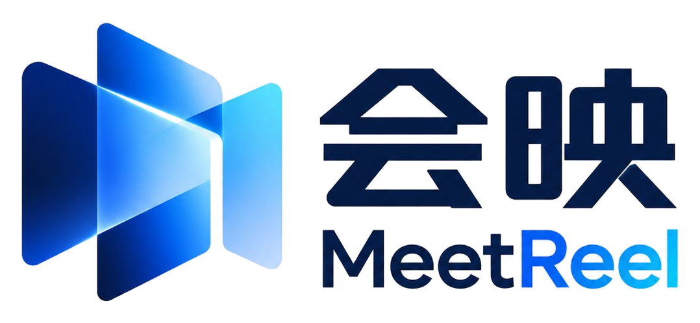

<p align="center">
  
</p>

<h1 align="center">会映 MeetReel</h1>

<p align="center"><b>开完会，每个人只收到和自己有关的那一份。</b><br>不来的人不掉线，来了的人不用记。</p>

<p align="center">苏客松 SU2026 · 思必驰命题 &nbsp;·&nbsp; <a href="#快速开始">快速开始</a> &nbsp;·&nbsp; <a href="#使用说明">使用说明</a> &nbsp;·&nbsp; <a href="#english-in-brief">English</a></p>

---

## 产品介绍

### 解决什么问题

一场会开完，发出去的是同一份纪要：太长没人看；看的人要自己找“哪条和我有关”；没来的人缺上下文；涉及预算、人事的内容发给谁，全靠主持人临时判断。

会映把会议拆成一本带原话出处的**事实账本**，再按每个人的角色、职责和权限，**各剪一份只讲 TA 的简报**，必要时剪成 30 秒的小片子。收到的人可以确认、改派、追问，结果再流回账本。

### 三个核心能力

| 能力 | 说明 |
|---|---|
| **影响链** | 会上没人点你的名，但你依赖的东西变了，你也会收到，并且写明“为什么发给你”。 |
| **按权限分发** | 同一条信息，财务看到预算数字，研发只看到“扩容已批”。权限用规则判断，不交给模型；受限条目对无权者根本不出现。 |
| **异步回流** | 收到的人确认、改派、追问；答不了的转问决策人；更正只通知收到过这一条的人。 |

另外两条原则：**每条结论都能点回会议录像里的那句原话**（溯源）；**一个人没有任何必读条目，就不打扰他**。

### 怎么工作的

会议录像 / 转写 进来后，由一组分工明确的智能体处理，最后停在“发送前预览”等主持人确认：

```
场记 → 议题官 → 抽取官 → 审核官 → 路由官 → 编辑官 → 投递官
转写    切议题    抽 6 类条目   校验原话    相关性×权限   按人改写     卡片 / H5
说话人            附原话出处    说话人      决定发给谁    “对你意味着什么”
```

- **6 类条目**：决议、待办、变更、风险、问题、信息，每条都带负责人、截止时间、敏感度和原话出处。
- **6 条路由理由**：R1 被点名 · R2 被角色点到 · R3 负责的东西被提到 · R4 依赖的东西变了 · R5 订阅的话题 · R6 角色通用规则。
- **4 级敏感度**：公开 / 内部 / 受限 / 机密，对照个人可见级别放行、脱敏或拦截。
- **按职级写简报**：高管只看决议、风险和投入；部门负责人看本部门相关的；成员只看自己的待办。

### 主案例

主案例是一段 9 分 49 秒的**小米汽车安全专场直播**：直播里没人点我们任何人的名，8 个收件人里 7 个收到内容不同的简报，1 个人没被打扰。同一家虚构车企本周的三场内部会议（安全周会、车主运营月会、门店销售周会）用来演示权限闸和跨会议问答。详见 [案例说明](data/cases/xiaomi-safety/README.md)。

---

## 快速开始

需要 **Node.js 20.19+ 或 22.12+**（Vite 7 的要求）。

```bash
git clone https://github.com/handsomeZR-netizen/MeetReel.git
cd MeetReel/web
npm install
npm run dev
```

浏览器打开 <http://localhost:5173>。

```bash
npm run build      # 类型检查 + 生产构建，输出 web/dist
npm run preview    # 本地预览构建结果
```

- **刷新页面就回到初始状态**；侧栏左下角的头像菜单里也有“重置演示数据”。
- 开发服务器监听所有网卡，同一局域网的手机可以用 `http://<电脑 IP>:5173` 打开。
- 页面是 hash 路由（`#/…`），可以直接发链接给别人。

---

## 使用说明

打开后你默认是**江晚**（品牌市场 · 竞品研究），也就是把这场直播上传、负责分发的人。下面是一条 5 分钟的参观路线。

### 1. 分发一场会

侧栏 **新建会映** → 上传会议录音，或导入会议链接 → 会映问你几件事（会议信息、所属项目、相关人、发送前要不要先看一眼）→ 多智能体开始工作。

- 导入链接会直接载入主案例。问答里点“都按推荐来，直接开始分发”可以跳过逐题回答。
- 画布依次出现：编排时间轴 → 账本流向收件人 → 路由矩阵 → 每人的便利贴简报。
- 20 秒的分发剧本在约 18.5 秒处**停下来等你确认**（发送前预览），点“确认发送”后继续投递；问答里选“直接发出”则不停。
- 想直接看分发过程，打开 [`#/dispatch/xm_safety?run`](http://localhost:5173/#/dispatch/xm_safety?run)。

### 2. 看收到了什么

侧栏 **与我有关**：

- **日程**：会议和待办放在同一张周 / 月历里。
- **会议**：我发布的、发给我的、全部会议；标明发布者、收到者和职级。
- 切换身份：页面里的“切换身份预览”，或在链接后加 `?as=<人>`（如 `?as=songlan`）。**权限闸和简报都按所选的人生效**，比如换成没有权限的人，受限条目就看不到或只看到脱敏版。

### 3. 溯源回放

点开任意一场会（侧栏“最近会议”）：

- 播放真录像：共享屏 + 发言人画面 + 逐字字幕。
- 多泳道进度条：章节、条目图钉、每人发言。
- 点逐字稿里的任意一个字，或任意条目上的“原话”，都会跳到录像的那一秒，条目卡片闪一下。
- 切到“成员”看某个人的简报：相关议题、待处理事项、为什么发给 TA、TA 的发言。

### 4. 每人 30 秒

侧栏 **每人 30 秒**：一场会不是每个人都要看完。左边是送达图（会议 → 各部门的人，旁边的点阵标出 20 条里哪几条是 TA 的），右边播选中那个人的 30 秒片子，每一条都写着“为什么是你”。右上角下拉可以换风格：

| 风格 | 参数 | 适合 |
|---|---|---|
| Apple 发布会 | `s=apple` | 高管 |
| 手绘便利贴 | `s=sketch` | 组长 |
| 波普漫画 | `s=pop` | 成员 |
| 3D 等距 | `s=iso` | 路演 |

### 5. 知识库与组织

- **会议知识库**（`#/kb`）：跨会议问答，回答附原话引用，点一下回到录像；也能按类型、项目筛选全部条目，并打开各场会的配套资料（纪要 PDF、对标表、截图等）。
- **组织与角色**（`#/org`）：会映据此判断信息流向。关注档案（负责 / 依赖 / 订阅）决定发不发，职级决定简报怎么写；鼠标移到一个人上看 TA 连着谁，点一下钉住。

### 小技巧

| 操作 | 方法 |
|---|---|
| 全局搜索会议、条目、原话、人 | `Ctrl K`（Mac 用 `⌘ K`） |
| 中英文 | 顶栏右上角 “EN / 中文”（切换会刷新页面，演示数据回到初始）；或新打开带 `?lang=en` 的链接 |
| 手机 | 窗口小于 768px 时侧栏收进抽屉 |
| 录屏 / 截图用的纯画面 | `#/reel?frame&s=pop&as=songlan&t=12` |

### 常用链接参数

| 地址 | 作用 |
|---|---|
| `#/` · `#/?v=meet` | 与我有关：日程 / 会议 |
| `#/m/<会议>?t=<秒>&item=<条目>` | 录像定位到某一秒并高亮条目 |
| `#/m/<会议>?tab=people&p=<人>` | 某个人的成员简报 |
| `#/shared?as=<人>` | 以某人的身份看发给 TA 的会议 |
| `#/reel?as=<人>&s=<风格>` | 某人的 30 秒片子 |
| `#/kb?q=<关键词>` | 知识库搜索 |

演示里的会议：`xm_safety`（小米汽车安全专场直播，主案例）、`sf_weekly`（安全周会）、`own_monthly`（车主运营月会）、`retail_weekly`（门店销售周会）。

---

## 目录

| 路径 | 内容 |
|---|---|
| [`web/`](web/) | 前端工作台（React 19 + Vite 7 + Tailwind v4 + shadcn/ui + motion），详见 [web/README.md](web/README.md) |
| [`data/cases/xiaomi-safety/`](data/cases/xiaomi-safety/) | 主案例：转写、20 条账本条目 + 29 条路由（同时是评测标准答案）、7 份个人简报、知识库资料 |
| [`data/video/`](data/video/) | 案例录像 |
| [`tools/file-assets/`](tools/file-assets/) | 生成演示用的配套文件（表格、文档、PPT） |
| [`archive/`](archive/) | 已并入 `web/` 的旧原型和参考资料，只留备查 |
| [`会映_会议信息按人分发_需求文档_v0.2.md`](会映_会议信息按人分发_需求文档_v0.2.md) | 产品需求：价值审视、核心机制、数据契约、评测指标 |
| [`会映_开发计划与案例数据_v0.1.md`](会映_开发计划与案例数据_v0.1.md) | 任务拆分、里程碑、公开数据集调研 |

### 重新生成案例数据

改了 `data/cases/xiaomi-safety/` 里的手写文件（`case.json`、`people.json`、`ledger.json`、`briefs.json`）后：

```bash
node data/cases/xiaomi-safety/build.mjs
```

脚本会校验每条原话必须在转写里且只命中一段、简报里的数字必须能在原话里找到、路由只能发给收件人，不通过就报错退出。知识库资料用 `make_kb.py` 生成，需要 reportlab、python-docx 和 ffmpeg，见 [案例说明](data/cases/xiaomi-safety/README.md) 的“知识库资料”一节。

### 部署

```bash
bash web/scripts/deploy.sh          # 构建当前分支已提交的 HEAD 并发布
```

脚本在干净副本里构建（不带未提交的改动），上传后把服务器上的 `current` 软链接切到新版本，回滚就是切回上一个。需要能免密 SSH 到目标服务器（默认读 `~/.ssh/config` 里的 `cityindex-server`，可用 `DEPLOY_HOST` 覆盖）。

---

## 素材与声明

- 案例录像是公开直播的节选，仅用于功能演示；直播里的四位发言人是真人，系统只引用他们的原话，不替他们生成简报或派任务。
- 收件人、车企背景、三场内部会议和配套文件**全部是虚构**的，与小米公司及任何真实组织无关。
- 第三方素材：手绘图标 [Koboyo Icons](https://koboyo.com/icons)、模型图标 Lobe Icons（MIT）、字体 Inter / JetBrains Mono / 霞鹜文楷（OFL）。详见 [web/README.md](web/README.md#第三方素材)。

---

## English in brief

**MeetReel** turns one meeting into many personal briefs. After a meeting, every person gets only what concerns them, each item linked to the exact quote in the recording and a one-line reason for why it was sent to them. Recipients can confirm, reassign or ask follow-ups, and the answers flow back.

What's different:

1. **Impact chain.** You get it even if nobody named you, when something you depend on changed.
2. **Permission-aware delivery.** The same decision is shown in full to finance and redacted for engineering, decided by rules, not by the model.
3. **Async loop-back.** Confirmations, reassignments and questions write back to a shared ledger.

This repo is an interactive front-end workspace with a worked case (a 9:49 car-safety livestream, 8 fictional recipients, 7 different briefs and 1 person left alone). The UI is bilingual.

```bash
git clone https://github.com/handsomeZR-netizen/MeetReel.git
cd MeetReel/web && npm install && npm run dev   # http://localhost:5173
```

Add `?lang=en` to any link (e.g. `#/?lang=en`) to open the English UI. Requires Node.js 20.19+ or 22.12+.
