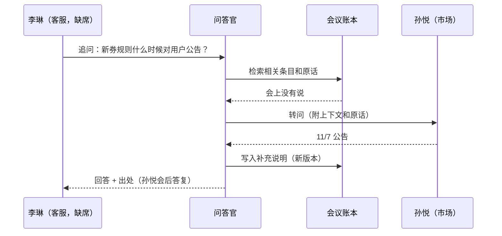
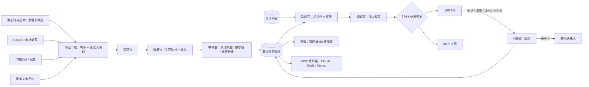

# 会映 MeetReel · 会议信息按人分发 · 需求文档 v0.2

> 苏客松 SU2026 · 思必驰命题 · 2026-10-31 凌晨 · 状态：待团队拍板
>
> 项目名称：会映 MeetReel。
>
> 这一版在你口述方案的基础上做了两件事：① 逐项泼冷水，判断哪些真有价值、哪些只是好看（第 1 节）；② 按结论重排需求和优先级（第 2 节起）。文中 [数字] 对应文末参考资料。

---

## 0. 一页摘要

**一句话**：开完一场会，每个人只收到和自己有关的部分，附原话、附“为什么发给你”；收到的人能直接确认、改派、追问，信息再流回来。**不来的人不掉线，来了的人不用记。**

**真正的新意只有三点**（其余都是基础设施，别当卖点讲）：

1. **影响链**：会上没人点你的名，但你依赖的东西变了，你也会收到。
2. **按权限分发**：同一场会，财务看到预算数字，研发只看到“扩容已批”。
3. **异步回流**：追问会议（答不了自动转问决策人）、确认或改派待办；结果写回账本，只通知收到过这一条的人。

**为什么值得做**

- 人按自己的角色判断什么重要，统一纪要里很多内容对个人不相关 [3]。
- 已有近三成员工靠 AI 笔记跳过会议，最大的担心是不准、丢细节 [4]。
- 思必驰首席产品官提到：纪要该按部门权限分发，目前靠人工判断该发给谁 [1]。

**出口**：飞书卡片是主载体（带原声片段）→ 确认、追问回流；管理者 90 秒视频（P1，限时）；研发收件箱 MCP（P1，限时）。

**模型**：Claude 用于开发和离线调优；现场运行用 DeepSeek（国内直连）。不讲“便宜”——一场会的模型成本约几毛钱，人的时间是几百上千元——讲“评测驱动、模型可替换、可私有化”。

**30 秒 Wow**：队员现场开 60 秒“双 11 上线评审会”。散会 60 秒内，8 个相关人里 7 人收到 7 份不同的纪要，1 人没被打扰：财务只收到 1 条；没来开会、也没被点名的客户端同学收到“你依赖的订单接口要改，负责人待你确认”。

**今晚**：锁定数据契约（第 8 节）、剧本和档案（第 14 节），做 3 个 spike（路由质量、飞书卡片回调、视频渲染），然后睡觉。

---

## 1. 先泼冷水：逐项价值审视

### 1.1 结论速览

| 组件 | 对真实用户 | 对评委（思必驰） | 新意 | 结论 |
|---|---|---|---|---|
| 按人分发（相关性路由） | 高：重要性因人而异 [3] | 高：CPO 点过这个方向 [1] | 中：想法不新，IBM 2019 年就申请了专利 [9]，Teams 今年推出了读者自选模板 [7] | **保留为核心**，只把“影响链 + 权限 + 回流”当卖点 |
| 待办、责任人、回溯原文、转任务 | 高 | 低：飞书智能纪要已经做了 [6]，思必驰办公本也有 [27] | 低 | **做，但当基础设施**，路演不当亮点 |
| 影响链（没被点名也收到） | 高 | 高 | 高 | **P0，Demo 的“啊哈”时刻** |
| 按权限分发 | 中高（企业） | 高 [1] | 中高 | **P0**，用规则实现，不交给模型 |
| 异步回流（确认、追问、转问） | 高：纪要没人看、决定落不了地，问题就在这 [5] | 高 | 较高 | **P0 做确认；追问、转问是 P1 第一优先** |
| 卡片里的原声片段 | 高：直接回应“丢细节、不敢信” [4] | 中 | 中 | **P0，成本低** |
| 每人一段视频 | 低：没人愿意为 3 条待办看视频 | 中 | 低 | **砍** |
| 管理者 90 秒视频 | 中低 | 中高（媒介冲击力） | 中 | **P1，限时 4 小时，可随时砍** |
| 运行时让 Claude Code 现写视频 | 无 | 低：现场不稳 | 低 | **砍**；开发期用 Claude Code 写模板即可 |
| DeepSeek 低成本 | 低：一场会约几毛钱 | 中：思必驰更关心可私有化、可端侧 | 低 | **换讲法**：评测驱动 → 模型可替换 |
| Claude 调优 DeepSeek 提示词 | 间接 | 中：有数字才算技术深度 | 中 | **P1，限时 4 小时**；没测出数字就不讲 |
| MCP + Skill 进 Claude Code / Codex | 中（研发团队） | 低中 | 低中：会议记录类 MCP 已有人做 [10] | **P1，限时 3 小时**，只做“我的条目 + 回写确认” |
| DeepSeek Harness 插件 | 低 | 低 | 低 | **砍**；最多在它里面挂一下我们的 MCP |
| 飞书 CLI | 看用途 | 低：评委看结果不看工具 | 低 | **P2**：只用来“只拉相关的人约下次会” |
| 会中实时要点 | 中 | 中 | 低：飞书已有实时要点 [6] | **P1 末位**，只做“缺负责人 / 截止时间”时举手提醒 |
| “实现不用思必驰，包装时说用到” | — | **负**：评委一问接口就露馅 | — | **改成诚实适配器**（第 11 节） |

### 1.2 最容易自嗨的四个假设

1. **“按人定制纪要是新点子。”** 不是。IBM 2019 年就申请了“按参会者在会议目标中的职能生成定制摘要”的专利 [9]；Teams 今年推出了读者自选模板的自定义 AI 摘要 [7]；Zoom 有只记“我关心的”个人笔记 [8]；飞书智能纪要能按会议类型定制总结、提炼待办和责任人、回溯原文、转飞书任务、按发言人分别总结 [6]。我们能站住的只有：**影响链、按权限分发、异步回流，以及三者形成的闭环**。

2. **“出口越多越厉害。”** 做会议助手的厂商自己都在说“纪要疲劳”：纪要生成了没人看，决定落不到干活的系统里 [5]（厂商博客，数据没有公开方法，只取观点）。每多一个出口，就多一条可能没人看的消息。衡量标准应该是“必读条目被确认、被完成了多少”，不是“生成了多少东西”。**与你无关的会，不发任何东西，这本身就是功能。**

3. **“便宜是卖点。”** 按 DeepSeek 当前价格，一场 1 小时会议的模型成本约 ¥0.25–0.5（第 10.2 节）；8 个人开 1 小时会的人力成本约 ¥1,200。换一个贵 10–20 倍的模型，一场会也只多几块钱。对思必驰真正有意义的是“可私有化、可端侧”——会议数据不出企业。

4. **“AI 能判断谁该知道什么。”** 模型不是瓶颈，**数据**才是。一是“谁说的”：说“我 11/5 前给接口”的人就是负责人；微软的纪要研究里，7 名参与者中有 4 人遇到 AI 把人称指代搞错 [3]。二是“谁依赖什么”：组织里的依赖关系不在录音里。这两块决定路由准确率，所以要在“改说话人”和“关注档案”上花功夫，而不只是调提示词。

另外，路演别说“让一半人不用来开会”：参会还关乎能见度和组织关系，容易被反驳。说“不来的人不掉线，来了的人不用记”更站得住。

### 1.3 因此对原方案的调整

| 原想法 | 调整 |
|---|---|
| AI 分析流程，组织信息，分发给需要的人 | 定义两道闸：相关性（该不该知道）× 权限（能不能知道）。相关性靠关注档案 + 影响链；每条推送附“为什么发给你” |
| 异步协作 | 补上回流：确认 / 不是我 / 改派、追问（答不了就转问决策人）、更正只通知收到过的人 |
| 结构化、视频、待办、MCP、插件、飞书 CLI 六个出口并列 | 卡片为主（带原声）；视频只留管理者版且限时；MCP 只做研发收件箱；dsh 插件砍；飞书 CLI 放 P2 |
| 调用 Claude Code 生成视频 | 开发期用 Claude Code + Remotion / HyperFrames 写好模板；运行时把 JSON 填进模板渲染 |
| 实现不用思必驰，包装时说用到 | 诚实适配器 + 明早去要设备和接口；把“说话人区分决定路由准确率”讲成思必驰硬件的价值 |
| DeepSeek + Harness + Claude 调优 → 低成本高效果 | 讲“评测驱动、模型可替换（云端 DeepSeek / 私有化 / 端侧小模型）”；限时 4 小时，没数字不讲 |
| 先用 Claude 打通 | 开发期用 Claude；现场运行切 DeepSeek（海外 API 在现场网络下不可控） |
| （未提）隐私、指标、兜底 | 4 级敏感度 + 主持人发送前预览；可测指标；回放模式和录屏兜底 |

---

## 2. 问题与定位

### 2.1 场景

一场 60 分钟的会，6–8 个相关的人里，常常只有两三个需要全程在场；其余人来，多半是怕漏掉和自己有关的那 5 分钟。会后发出的是一份统一纪要：太长没人看；看的人得自己找“哪条和我有关”；没来的人缺上下文；涉及预算、人事的内容发给谁，全靠主持人临时判断。

### 2.2 证据

- **会议过载**：员工平均每周参加约 17.7 场会、约 18 小时，自认必要的只有 11.8 场；53% 的人明知会议不必要，仍觉得非去不可 [2]。
- **重要性因人而异**：微软研究院的纪要原型研究里，参与者按自己的角色判断重要性；7 人中 6 人认为部分要点与自己无关，希望把与自己最相关的排在前面，并能回到原始记录 [3]。（样本小，只说明方向。）
- **已经有人靠 AI 跳会**：29% 的受访员工用 AI 笔记和摘要来跳过会议；最担心的是不准或丢失细节（48%），其次是隐私（46%）[4]。
- **思必驰自己的判断**：难点在会后执行；纪要该按部门权限分发，目前靠人工判断 [1]。

### 2.3 竞品做到了哪里

| 能力 | 谁已做到 | 我们怎么做 |
|---|---|---|
| 纪要、章节、待办与责任人、回溯原文、转任务、实时要点、声纹识人 | 飞书智能纪要 [6]；思必驰 AI 办公本 [27] | 当底座，不当卖点 |
| 读者自选模板定制纪要 | Teams Copilot 自定义 AI 摘要 [7] | 不靠读者自己去拉，而是推给该知道的人，包括没参会的 |
| 个人只记“我关心的” | Zoom My Notes [8] | 在团队层面分发，带权限和回流 |
| 按参会者职能生成定制摘要 | IBM 专利（2019 年申请）[9] | 想法早有；差异在影响链、权限、回流的闭环 |
| 会议记录接入编码 Agent（MCP） | SpeakApp 官方 MCP、Granola 社区 MCP 等 [10] | 只返回“与我有关”的条目，并能回写确认 |

### 2.4 定位

不是“更好的纪要”，而是**会后信息路由 + 异步回流**。

- **对思必驰**：这是办公本 / Office AI 的差异化能力；硬件的说话人区分越准，它就越准。
- **对投资人（如实说）**：单独成立公司，飞书、Teams 跟进会很快；更现实的路径是做进终端厂商和办公平台。

---

## 3. 用户与角色

| 角色 | 例子 | 他要什么 | 在哪里收 |
|---|---|---|---|
| 主持人 / 发起人 | 产品经理 | 会后不用手写纪要、不用逐个私聊同步；知道谁确认了 | 主持人控制台 |
| 参会者 | 后端负责人 | 只看自己的待办和受影响的决定，30 秒内看完 | 飞书卡片 |
| 未参会的相关人 | 客户端、客服 | 不来也不漏；有疑问能追问 | 飞书卡片 / Claude Code |
| 管理者 | 业务负责人 | 决议、风险、待签批事项；有空再看视频 | 卡片 + 90 秒视频 |
| 受限信息的接收者 | 财务 | 只看和自己有关的预算事项 | 飞书卡片 |
| 研发 | 客户端开发 | 会上定的接口变更直接进编码 Agent 的上下文 | MCP 收件箱 |

---

## 4. 核心机制

### 4.1 会议事实账本（单一事实源）

所有 Agent 只读写同一本账。每条信息单元带：类型、负责人、截止时间、影响对象、敏感度、原话出处（发言人、时间戳、原文片段）、状态和版本。每个人看到的简报，都是这本账的一个“个人视图”。这和思必驰“大模型做中枢 + 多个垂域智能体”的架构思路一致 [26]。

### 4.2 信息单元（6 类）

| 类型 | 含义 | 例子 |
|---|---|---|
| 决议 decision | 定下来的事 | 扩容走 A 方案 |
| 待办 action | 谁、何时、交付什么 | 陈默 11/5 前给新接口 |
| 变更 change | 改了原计划 | 上线从 11/11 提前到 11/8 |
| 风险 risk | 可能出问题的地方 | 周四前压测做不完，8 号上线有风险 |
| 问题 question | 没定、待确认 | 新券规则什么时候对用户公告？ |
| 信息 info | 同步一下的事实 | 法务认为原券面额有风险 |

### 4.3 关注档案（Profile）

每人一份：角色和别名（“客户端”“小赵”）、负责什么（owns）、依赖什么（depends_on）、关注什么（interests）、可见级别（clearance）、接收渠道。

依赖数据从哪来（评委一定会问）：

| 情况 | 来源 |
|---|---|
| Demo | 手写 8 份档案 |
| 研发团队 | CODEOWNERS、服务依赖关系、接口文档的负责人 |
| 业务团队 | 项目表 / 多维表格里的负责人和依赖字段、群成员 |
| 冷启动 | 一句话自述 + 历史被点名记录 + “不相关 / 我也该知道”的反馈（P2） |

### 4.4 两道闸：相关性 × 权限

原则：**推送看相关，可见看权限**。完整纪要按权限随时可查；主动推送只推相关的。

相关性理由（每条推送都显示给收件人）：

| 代码 | 理由 | 例子 | 默认级别 |
|---|---|---|---|
| R1 | 被点名或被分配 | “陈默负责压测” | 必读 |
| R2 | 被角色点到 | “客服 7 号前把 FAQ 更新好” | 必读 |
| R3 | 负责的东西被提到 | 订单接口 → 后端负责人 | 必读 |
| R4 | 依赖的东西变了（影响链） | 订单接口字段改了 → 依赖它的客户端 | 必读 |
| R5 | 订阅的话题 | 关注“上线时间” | 建议看 |
| R6 | 角色通用规则 | 管理者收全部决议和风险 | 按规则配置（如管理者的决议和风险为必读） |

推送级别：必读（直接展示）/ 建议看（展示标题）/ 可选（折叠）/ 不推送。**一个人如果没有任何必读条目，就不即时推送**，条目进日报（P2）。

权限闸：条目敏感度（公开 / 内部 / 受限 / 机密）× 个人可见级别 → 放行 / 脱敏（如“扩容按 A 方案推进”，不显示金额）/ 拦截。受限条目对无权者**根本不出现**；主持人预览里显示锁标。权限用规则判断，不交给模型。

R4 是和“谁被提到就发给谁”的本质区别：会上没人点赵一的名，但他依赖的接口变了，他就该知道。

### 4.5 按人改写：少改写，多引用

同一事实，对不同人的意义不同：对后端是“你 11/5 前交付”，对客户端是“11/5 后需要适配”，对管理者是“接口调整，不影响上线”。但改写最容易出错，所以：

1. 只改写“对你意味着什么”这一句；事实部分用结构化字段（谁、做什么、何时）和原话，**不让模型复述数字和日期**。
2. 每条附原话（可点击播放）和理由标签。
3. 排序：待办 → 变更、决议 → 风险 → 信息。
4. 估算阅读时长，目标每人 ≤ 60 秒。

### 4.6 异步回流

| 动作 | 谁发起 | 发生什么 |
|---|---|---|
| 确认 / 不是我 / 改派 | 待办负责人 | 账本更新；改派后新负责人收到带原话的卡片；主持人看板变色 |
| 追问 | 任何收件人 | 问答官用账本和转写回答，附出处；答不了就转问决策人，回答回流给提问者并写回账本 |
| 不相关 / 我也该知道 | 任何人 | 本场先人工修正；P2 用来调整档案权重 |
| 更正 | 主持人或问答官 | 条目升版本，**只通知收到过这一条的人** |



### 4.7 人在回路

| 级别 | 例子 | 规则 |
|---|---|---|
| 读 | 生成账本、简报 | 自动 |
| 建议 | 推荐收件人、推荐负责人、推荐下一步 | 自动，可改 |
| 执行 | 发卡片、建任务、约会议 | 主持人或负责人确认；可设“低敏感 + 高置信时自动发送” |
| 不可逆 / 对外 | 发外部邮件、删数据 | 不做 |

这与思必驰“权限分阶段放开、高风险操作最严、关键一步由人把关”的做法一致 [1]。

---

## 5. 主流程与 Demo 用例

### 5.1 一场会的生命周期

| 阶段 | 发生什么 | 优先级 |
|---|---|---|
| 会前 | 主持人选相关人，系统加载档案；缺席者可预先提问 | 档案 P0；预先提问 P2 |
| 会中 | 实时转写，条目在主持人台上“长出来”；缺负责人或截止时间时举手提醒 | P1 |
| 散会 | 账本定稿 → 路由 → 改写 → 主持人预览矩阵 → 一键发送 | P0 |
| 会后 | 卡片、视频、研发收件箱；确认、追问、更正回流 | 卡片和确认 P0；其余 P1 |

### 5.2 Demo 用例：双 11 活动上线评审会

3 人参会（队员扮演），5 人缺席。同一场 60 秒的会，散会后：

| 人 | 参会 | 收到什么 | 为什么 | 阅读时长 |
|---|---|---|---|---|
| 林总（业务负责人） | 否 | 3 条决议 + 1 条风险 + 预算待签批；90 秒视频 | R6 管理者规则 | 约 60 秒 |
| 王珂（产品，主持） | 是 | 主持人版卡片（全量）+ 确认看板 | 主持人 | — |
| 陈默（后端） | 是 | 2 条待办（新接口 11/5、周四压测）+ A 方案决议 + 压测风险 | R1、R3 | 约 20 秒 |
| 孙悦（市场） | 是 | 物料待办（11/6）+ 券规则变更 + 上线时间 | R1、R3、R5 | 约 20 秒 |
| 赵一（客户端） | 否 | 客户端适配新接口（负责人待确认）+ 上线提前到 11/8；Claude Code 收件箱里也有 | R2、R4，**会上没人点他的名** | 约 20 秒 |
| 李琳（客服主管） | 否 | FAQ 待办（11/7）+ 券规则变更 + 上线时间 | R2、R4 | 约 20 秒 |
| 周宁（财务） | 否 | **只有 1 条**：A 方案扩容预算约 30 万，待签批 | R2；受限信息只给她和林总 | 约 10 秒 |
| 吴桐（数据分析） | 否 | **不推送**：本场没有必读，上线日期变化进日报 | 只有 R5 | 0 秒 |

路演一句话：**8 个相关人，7 份不同的纪要，1 个人没被打扰。**

---

## 6. 功能需求与优先级

### P0：必须（10/31 20:00 前端到端跑通）

| ID | 功能 | 说明 | 验收 |
|---|---|---|---|
| F01 | 会议输入 | 录音或音频文件 → 统一转写 JSON（说话人、时间戳）；可直接导入剧本文本兜底 | 3 分钟、3 人的录音 30 秒内出转写；说话人可在控制台一键映射到人 |
| F02 | 账本生成 | 议题切分 + 6 类条目抽取，每条必须带原话 | 剧本会议的标准条目抽出 ≥ 90%；每条原话都能在转写中找到 |
| F03 | 关注档案 | JSON 配置 + 控制台查看和修改 | 8 份 Demo 档案可加载、可改 |
| F04 | 路由 | 人 × 条目 → 级别 + 理由 + 权限；无必读不推送 | 评测集“必读”召回 ≥ 90%；受限条目泄露 = 0 |
| F05 | 个人简报 | 按 4.5 节改写和排序；输出卡片 JSON 和 H5 页；每条带原声片段 | 每人 ≤ 60 秒读完；每条有理由和原话 |
| F06 | 分发预览 | 人 × 条目矩阵，主持人可勾选改动，一键发送 | 改动立即反映到对应简报 |
| F07 | 飞书投递 | 机器人给每人发互动卡片；长连接接收按钮回调 | 3 分钟的会，散会到全员收到 ≤ 60 秒 |
| F08 | 待办确认 | 卡片上确认 / 不是我 / 改派 | 状态写回账本，主持人台实时可见 |

### P1：应该（按顺序做，每项限时，超时就停）

| ID | 功能 | 限时 | 说明 | 验收 |
|---|---|---|---|---|
| F09 | 追问与转问 | 4 小时 | 问答官带出处回答；答不了转问决策人，回答回流并写回账本；更正只通知收到过的人 | 李琳追问 → 孙悦回复 → 李琳收到，系统耗时 ≤ 30 秒（不含人回复） |
| F10 | 分发动画大屏 | 3 小时 | 条目从会议时间轴飞向每个人的头像；“未打扰”的人显示灰色 | 路演可用 |
| F11 | 管理者 90 秒视频 | 4 小时 | 模板渲染：议题地图、3 条关键决议（原声 + 字幕）、风险、待办片尾 | 3 分钟的会，视频 3 分钟内渲染完 |
| F12 | 模型评测与 DeepSeek 调优 | 4 小时 | ModelRouter 一键切换；评测集；调优报告 | 出三组对比表（质量、延迟、单场成本） |
| F13 | 研发收件箱 | 3 小时 | MCP Server（5 个工具）+ SKILL.md + Claude Code 插件 | 在 Claude Code 里问“会上给我定了什么”，返回带原话的条目 |
| F14 | 会中举手 | 3 小时 | 边开会边出条目；缺负责人 / 截止时间时在主持人台角落亮灯 | 条目延迟 ≤ 10 秒 |

### P2：可以（有余力再做）

| ID | 功能 | 说明 |
|---|---|---|
| F15 | 执行官 | 用飞书 CLI 先 dry-run 预览再执行：只拉相关的人约下次会（查空闲，对应命题里的“时间协同”） |
| F16 | 会前异步提问 | 缺席者提前提问；会中讨论到时提醒主持人；会后自动答复 |
| F17 | Codex 插件 | F13 完成后加一份清单文件，约 30 分钟 |
| F18 | 端侧小模型实验 | 路由官换成本地 7B 级量化模型，看评测掉多少；掉得少就是“可端侧”的证据 |
| F19 | 反馈学习 | “不相关 / 我也该知道”调整档案权重 |
| F20 | 自动识人 | 从飞书日历读邀请名单和缺席者；声纹注册 |
| F21 | 日报 | 只有“建议看 / 可选”的条目，汇总成每天一条 |

### 明确砍掉

每人一段视频；运行时让 Claude Code 写视频代码；DeepSeek Harness 插件；声音克隆和数字人；PPT 精修与课件批注（命题方向之一，主动不做）。

---

## 7. 多智能体设计

### 7.1 角色

| Agent | 职责 | 实现 |
|---|---|---|
| 调度官（中枢） | 维护账本，调度其他 Agent，重试和降级 | 代码 |
| 场记 | 转写适配、说话人映射、时间戳、切原声片段 | ASR + 规则 + FFmpeg |
| 议题官 | 切分议题，生成议题地图 | LLM |
| 抽取官 | 按议题抽 6 类条目，必须附原话 | LLM（按议题并行） |
| 审核官 | 原话是否真在转写里；待办缺不缺负责人 / 截止；敏感分级 | 规则 + LLM |
| 路由官 | 人 × 条目的级别、理由、权限 | 规则（R1–R3、权限）+ LLM（R4 影响链、R5） |
| 编辑官 | 按人改写“对你意味着什么”、排序、估阅读时长 | LLM（每人并行） |
| 导演 | 选原声片段，生成视频分镜 JSON | LLM + 模板 |
| 投递官 | 飞书卡片、H5 链接、MCP 收件箱 | 代码 |
| 问答官 | 追问回答、转问、写回账本 | LLM + 检索 |
| 执行官（P2） | 用飞书 CLI 预览和执行下一步 | LLM + CLI |

多数 Agent 本质是“一次结构化 LLM 调用 + 规则校验”。多智能体的看点不在进程数量，而在**共享账本、看得见的分工、人能随时插手**。

### 7.2 编排



### 7.3 协作协议

1. **来源必填**：没有原话指针的条目，审核官直接打回。
2. **结构化输出**：所有 LLM 输出走 JSON Schema（Pydantic 校验）；失败时带错误信息重试 1 次，再失败走规则兜底。
3. **举手而不插话**：会中提醒只在主持人台角落亮灯，主持人点了才展开。
4. **版本化**：条目更正升版本，不覆盖旧记录。
5. **可观测**：每个 Agent 的输入、输出、耗时、token 都记日志，供评测和“Agent 工作台”展示。

### 7.4 让评委看见多智能体

主持人台侧栏放“Agent 工作台”，实时滚动：“抽取官：新增待办 it_05（客户端适配，缺负责人）”“路由官：it_05 → 赵一（你负责客户端，且依赖订单接口）”。这一屏比架构图更有说服力。

---

## 8. 数据契约（给 Claude Code 实现时直接用）

字段可加不可删。示例用 jsonc，注释仅作说明。

### 8.1 转写 Transcript

```jsonc
{
  "meeting_id": "m_d11_review",
  "title": "双 11 活动上线评审",
  "source": "funasr",              // funasr | aispeech_export | feishu_minutes | script
  "started_at": "2026-10-31T10:00:00+08:00",
  "speakers": [
    {"spk": "S1", "person_id": "wangke", "confidence": 0.93},
    {"spk": "S2", "person_id": "chenmo", "confidence": 0.88}
  ],
  "segments": [
    {
      "seg_id": "g07",
      "spk": "S2",
      "start": 21.4, "end": 28.9,     // 秒
      "text": "那订单接口的 coupon_amount 要拆成两个字段，客户端也得跟着改。新接口我 11 月 5 号前给。",
      "audio": "clips/g07.mp3"
    }
  ]
}
```

### 8.2 信息单元 LedgerItem

```jsonc
{
  "item_id": "it_05",
  "meeting_id": "m_d11_review",
  "type": "action",                  // decision | action | change | risk | question | info
  "title": "客户端适配拆分后的订单接口",
  "detail": "coupon_amount 拆为两个字段，客户端需同步修改",
  "topic": "接口",
  "owner": null,                     // 会上没说是谁
  "suggested_owner": {"person_id": "zhaoyi", "basis": "R2:客户端"},
  "due": null,
  "depends_on_items": ["it_04"],     // 依赖陈默 11/5 交付的新接口
  "entities": ["订单接口", "coupon_amount", "客户端"],
  "mentions": {"people": [], "roles": ["客户端"]},
  "sources": [{"seg_id": "g07", "quote": "客户端也得跟着改", "start": 21.4, "end": 28.9}],
  "sensitivity": "internal",         // public | internal | restricted | confidential
  "visible_to": null,                // restricted 及以上时列出可见的人或角色
  "redacted_view": null,             // 无权者看到的脱敏版本；为 null 表示无权者完全看不到
  "flags": ["missing_owner", "missing_due"],   // 审核官打的标，会中触发举手
  "confidence": 0.82,
  "status": "proposed",              // proposed | confirmed | reassigned | done | retracted
  "version": 1
}
```

受限条目示例：

```jsonc
{
  "item_id": "it_07",
  "type": "action",
  "title": "扩容预算待财务签批",
  "detail": "A 方案，预算约 30 万",
  "owner": "zhouning",
  "sensitivity": "restricted",
  "visible_to": ["role:财务", "linzong", "wangke", "chenmo"],
  "redacted_view": "扩容按 A 方案推进（预算细节受限）"
}
```

### 8.3 关注档案 Profile

```jsonc
{
  "person_id": "zhaoyi",
  "name": "赵一",
  "role": "客户端负责人",
  "aliases": ["客户端", "App 端", "小赵"],
  "owns": ["App 客户端"],
  "depends_on": ["订单接口", "活动页"],
  "interests": ["上线时间", "接口变更"],
  "clearance": "internal",
  "channels": {"feishu_open_id": "ou_xxx", "mcp": true},
  "prefs": {"max_must_items": 5, "video": false}
}
```

### 8.4 路由决策 RoutingDecision

```jsonc
{
  "item_id": "it_05",
  "person_id": "zhaoyi",
  "tier": "must",                    // must | should | fyi | none
  "reasons": ["R2:客户端", "R4:依赖订单接口"],
  "permission": "allow",             // allow | redact | deny
  "score": 0.91,
  "decided_by": "rule+llm"
}
```

### 8.5 个人简报 Brief

```jsonc
{
  "brief_id": "b_zhaoyi_m_d11_review",
  "person_id": "zhaoyi",
  "meeting_id": "m_d11_review",
  "headline": "这场会和你有关的 2 件事：订单接口字段要拆（客户端适配，负责人待你确认）；活动提前到 11/8 上线。",
  "read_seconds": 20,
  "sections": [
    {"tier": "must", "items": [
      {
        "item_id": "it_05",
        "for_you": "后端 11/5 前给新接口，之后客户端需要适配。会上没定负责人，建议是你。",
        "facts": {"what": "coupon_amount 拆为两个字段", "who": "待确认", "when": "11/5 之后"},
        "why_you": "你负责客户端，且依赖「订单接口」",
        "source": {"speaker": "陈默", "at": "00:21", "quote": "客户端也得跟着改", "audio": "clips/g07.mp3"},
        "actions": ["confirm", "not_me", "ask"]
      }
    ]},
    {"tier": "fyi", "collapsed": true, "count": 1}
  ],
  "full_minutes_url": "/m/m_d11_review?as=zhaoyi"
}
```

### 8.6 视频分镜 VideoSpec

```jsonc
{
  "template": "meeting_90s",
  "audience": "linzong",
  "fps": 30, "size": [1280, 720],
  "scenes": [
    {"kind": "title", "text": "双 11 活动上线评审 · 3 人参会 · 5 人缺席", "dur": 3},
    {"kind": "topic_map", "topics": ["券规则", "上线时间", "接口", "扩容", "客服"], "dur": 6},
    {"kind": "decision", "item_id": "it_01", "caption": "券改为满 300 减 30（法务风险）", "clip": "clips/g01.mp3", "dur": 8},
    {"kind": "decision", "item_id": "it_03", "caption": "上线提前到 11/8，预热三天", "clip": "clips/g03.mp3", "dur": 6},
    {"kind": "risk", "item_id": "it_09", "caption": "周四前压测做不完，8 号上线有风险", "clip": "clips/g11.mp3", "dur": 6},
    {"kind": "todo_credits", "items": ["it_02", "it_04", "it_05", "it_07", "it_08", "it_10"], "dur": 8},
    {"kind": "outro", "text": "点开卡片可以追问任何一条", "dur": 3}
  ]
}
```

### 8.7 回流事件 Event

```jsonc
{
  "event_id": "ev_031",
  "type": "ask",                     // confirm | not_me | reassign | ask | answer | not_relevant | missed | correct
  "item_id": "it_01",
  "person_id": "lilin",
  "payload": {"question": "新券规则什么时候对用户公告？"},
  "ts": "2026-10-31T10:05:12+08:00"
}
```

---

## 9. 交付渠道

### 9.1 飞书（主载体）

- 建一个测试企业 + 企业自建应用 + 机器人；权限按服务端 SDK 文档申请（至少要能以应用身份发消息）。
- 事件和回调的订阅方式都选**长连接**：本地服务主动连飞书，不需要公网地址，比赛现场直接可用；卡片按钮回调要在 **3 秒内**响应 [15]。做法是先回一个提示，再异步处理、更新卡片。
- 给个人发卡片需要对方的 open_id：今晚把队员和测试账号的 ID 写进档案。
- 卡片上的“听原话”“看全文”按钮链接到 H5：**手机必须能访问到这台电脑**（同一热点 + 局域网 IP），或者把 H5 静态页和音频放到公网静态托管。
- 飞书 CLI（lark-cli）：飞书官方开源（MIT），200 多条命令覆盖日历、消息、文档、多维表格、任务、视频会议等业务域，自带 Agent Skill，可用 npm 安装 [11][12]，一行安装命令见 [13]；输出结构化 JSON，支持 `--dry-run` 预览 [14]。只在 P2 执行官里用：先 dry-run 给负责人看，确认后再执行。具体子命令以 `--help` 为准。
- 注意：飞书智能纪要本身已经能把待办转成飞书任务 [6]，所以“建任务”不是我们的增量，别花时间。

### 9.2 H5 个人页

给不在飞书测试企业里的人（比如评委）用：扫码 → 选身份（Demo 用）→ 看到“自己那份” → 点原话播放 → 可以追问。也是“手机墙”的素材。

### 9.3 管理者 90 秒视频（P1，限时 4 小时）

- **框架二选一**
  - Remotion：用 React 写视频，官方提供 Claude Code 插件和 Agent Skills（Codex、Cursor 也能用）[19]；商用许可对公司规模有要求，以官网为准。
  - HyperFrames：HeyGen 开源（Apache-2.0），HTML 经无头 Chrome + FFmpeg 渲染成确定性的 MP4，自带 Agent Skills [20]；需要 Node 22+ 和 FFmpeg [20]。
  - 选法：前端同学熟 React 就用 Remotion，否则用 HyperFrames。
- **开发期**：用 Claude Code（装好对应 Skills）把模板写好、调好。**运行时**：后端输出 VideoSpec（8.6 节）→ 渲染脚本 → 720p MP4。不在现场让 Agent 临时写视频代码。
- **原声比配音有说服力**：关键决议直接放发言人原声 5–8 秒 + 字幕，旁白可以省。
- 先发卡片，视频随后送达；视频只在企业内分享；不做声音克隆、不做数字人。

### 9.4 研发收件箱：MCP + Skill（P1，限时 3 小时）

会议记录接入 MCP 已经有人做了 [10]，所以只做差异：**只返回“与我有关”的条目、带原话、能回写确认**。

| 工具 | 参数 | 返回 |
|---|---|---|
| `meeting_inbox` | `person_id?`、`since?`、`tier?`（默认 must） | 与我有关的条目（理由、原话、截止） |
| `get_brief` | `meeting_id`、`person_id?` | 个人简报 |
| `ask_meeting` | `meeting_id`、`question` | 答案 + 出处；答不了时返回已转问给谁 |
| `get_source` | `item_id` | 原话、时间戳、音频链接 |
| `update_action` | `item_id`、`status` / `owner` / `due` | 更新后的条目（调用前先征得用户同意） |

“我是谁”用环境变量 `ZHIHUI_PERSON_ID` 指定，Demo 够用。

SKILL.md 草稿：

```markdown
---
name: meeting-inbox
description: 用户开始写代码、问“会上定了什么 / 我有什么待办”、或需求有歧义时使用；查询会议收件箱，以会议原话为准。
---
# 会议收件箱
1. 会话开始时调用 meeting_inbox，只展示 tier=must 的条目，每条带原话和截止时间。
2. 改接口、字段、日期之前，先用 get_source 取原话，按原话执行。
3. 需求有歧义时调用 ask_meeting，不要自己猜；答不了的问题工具会转给决策人。
4. 做完后建议调用 update_action 标记完成，先征得用户同意。
5. 提交信息里引用条目 ID（如 it_05），方便回溯。
```

打包：

```text
plugin/
├── .claude-plugin/plugin.json   # Claude Code 插件清单（只有 name 必填）
├── .codex-plugin/plugin.json    # Codex 插件清单（P2）
├── .mcp.json                    # 两边共用：启动本地 MCP Server
└── skills/meeting-inbox/SKILL.md
```

- Claude Code 插件的清单放在 `.claude-plugin/plugin.json`，skills、`.mcp.json` 放在插件根目录；插件名不能以 `claude-` 开头；用 `claude plugin validate ./plugin` 检查 [29]。
- SKILL.md 是开放格式，Claude Code、Codex、Cursor、OpenClaw 等都能读 [18]，写一份多处用。Codex 从 2026 年 3 月起支持把 skills、MCP 配置打成可安装插件 [16]，目录写法可参考 [17]。
- DeepSeek Harness（dsh）是 DeepSeek 开源的 Agent 框架，“一切皆插件”，支持 MCP，目前仍是开发者预览 [24]。不做插件；如果想展示，在它的配置里挂我们的 MCP 即可。

---

## 10. 模型、成本与评测

### 10.1 分工

| 阶段 | 模型 | 用途 |
|---|---|---|
| 开发期 | Claude（经 Claude Code） | 写代码、写模板、写初版提示词、起草剧本和标注草稿 |
| 运行时（现场） | DeepSeek 当前主力 Flash 模型 | 抽取、路由（R4/R5）、改写、问答 |
| 离线调优 | Claude 读失败样例、改提示词 | 让 DeepSeek 在我们的任务上接近 Claude 基线 |

- 所有 LLM 调用经同一个 ModelRouter，`LLM_PROVIDER=deepseek|claude` 一键切换；DeepSeek 走 OpenAI 兼容接口。模型名以 DeepSeek 官方文档为准：9 月起官方已把 V4 Pro 的请求路由到 V4.1 Flash [22]。
- 运行时用 DeepSeek 的另一个原因：现场网络下海外 API 的连通性不可控。

### 10.2 单场成本（粗估，需用实测替换）

DeepSeek 8 月起实行高峰 / 闲时计价，高峰为北京时间 9–12 点和 14–18 点 [21]。V4.1 Flash 闲时每百万 token：缓存命中输入 ¥0.02、未命中输入 ¥1、输出 ¥4，高峰为两倍 [22]。

| 假设 | 数值 |
|---|---|
| 会议 | 60 分钟、8 个相关人、转写约 1.5 万字 |
| 全流程 token | 约 15 万输入 + 2.5 万输出（含重试，粗估） |
| 高峰价、无缓存 | 0.15 × ¥2 + 0.025 × ¥8 ≈ **¥0.50 / 场** |
| 闲时价、无缓存 | ≈ ¥0.25 / 场 |
| 高峰价、80% 输入命中缓存 | ≈ ¥0.27 / 场 |
| 对照：8 人开 1 小时会的人力 | 按每人每小时 ¥150 估，约 ¥1,200 |

结论就是第 1.2 节说的：**成本不是卖点**。路演多在白天，可能落在高峰时段；媒体报道这轮调价与算力紧张有关 [21]。Demo 用的结果要提前跑好缓存，现场留一个模型切换开关。

### 10.3 提速与降本

1. **共享前缀**：各 Agent 的提示词把转写或账本放在相同的开头，吃到缓存价（缓存命中价约为未命中的 1/50）。
2. **规则前置**：R1–R3 和权限用规则算；LLM 只做 R4、R5 和改写。
3. **并行**：抽取按议题并行，改写按人并行。
4. **先卡片后视频**：视频不挡卡片。

### 10.4 评测集与指标

- **3 场剧本会议**：双 11 上线评审（Demo 用）、项目周会、学校教研会（证明能用在教学场景）。每场 5–10 分钟、5–8 个角色、10–15 个标准条目。
- **标注**：Claude 可以起草，**最终由队员人工定稿**：每条的类型、负责人、截止；每个（人，条目）的级别；敏感度。
- 留 1 场做最终测试，不参与调优。

| 指标 | 定义 | 目标 |
|---|---|---|
| 条目召回 / 精确 | 抽出的条目与标准条目的匹配 | ≥ 90% / ≥ 85% |
| 负责人和截止准确率 | 待办字段正确 | ≥ 90% |
| 必读召回 | 每人该必读的都推到了 | ≥ 90% |
| 推送精确 | 推给某人的条目里确实相关的比例 | ≥ 80% |
| 越权泄露 | 受限条目推给了无权者 | **0** |
| 原话有效率 | 原话能在转写里找到 | 100%（不通过不发） |
| 人均阅读时长 | 按字数估 | ≤ 60 秒 |
| 延迟、单场成本 | 实测 | 写进报表 |

目标是内部标准，不是承诺；路演只报测到的数字。

产品上线后真正要看的是：**必读条目 24 小时内的确认率**，以及**追问后不用再开会就解决的比例**。

### 10.5 调优流水线

```text
0. Claude 跑基线 → 记分
1. DeepSeek 用同一套提示词跑 → 记分（通常会掉）
2. 循环 3–5 轮：
   DeepSeek 跑开发集 → 汇总失败样例
   Claude 读失败样例和当前提示词 → 提出修改（补规则、换示例、拆步骤、改 Schema 描述）
   重跑 → 开发集提升且泄露仍为 0 才保留
3. 在留出的测试会上跑一次 → 出表
```

可以直接在 Claude Code 里跑：让它读 `eval/report.json`、改 `prompts/` 目录、再跑评测。思路和 DSPy 的 GEPA（反思式提示词进化）同类，48 小时内手工版就够。**P0 没跑通之前不开始。**

| 配置 | 条目 F1 | 必读召回 | 泄露 | 单场延迟 | 单场成本 |
|---|---|---|---|---|---|
| Claude 基线 | | | | | |
| DeepSeek 原始提示词 | | | | | |
| DeepSeek 调优后 | | | | | |

### 10.6 讲法与边界

- **讲法**：“我们评测驱动，所以敢换模型：云端用 DeepSeek，企业可以私有化，端侧可以换小模型。”
- **私有化是真的，端侧要另说**：以 DeepSeek V4 Flash 为例，它以 MIT 协议开放权重，但总参数约 3040 亿（每个 token 激活约 130 亿），自建至少要两张 H200 级别的显卡；之后的 V4.1 Flash 据报道更大 [23]。所以私有化在企业机房可行；端侧要换小模型（P2 的 F18 实验）。
- **边界**：只用 Claude 调提示词和流程、做评测，**不要把 Claude 的输出当训练数据去微调 DeepSeek**——Anthropic 的服务条款限制用其服务开发或训练与之竞争的模型；真要做蒸馏，先看条款。

---

## 11. 与思必驰命题的结合（诚实版）

### 11.1 命题对应

| 命题方向 | 我们怎么体现 |
|---|---|
| 智能助教与会议助手 | 会议账本 + 个人简报 + 追问；教研会、家长会同样适用（评测集里放一场教研会） |
| 多智能体协作完成信息交互 | 11 个角色围绕一本账协作；人和人之间的信息交换由 Agent 代办（转问、回流） |
| 时间协同与资源分配 | P2：只拉相关的人约下次会；待办截止冲突提醒 |
| 智能板书与语音结构化撰写 | 语音 → 结构化账本（决议、待办、变更、风险、问题） |
| PPT 精修与课件批注 | 主动不做 |

### 11.2 与思必驰办公 AI 思路的对应

思必驰首席产品官的原话是“会议只是一个事情的开始，执行才是一个大头” [1]。他提到的几个方向，和我们一一对应 [1]：

- 会后由 AI 接着推进 → 待办确认、转问、（P2）执行官；
- 主动提议、征得同意再做 → 发送前预览、执行前确认；
- 待办可以追溯到原始讨论 → 每条带原话和原声；
- 权限分阶段放开、关键一步由人把关 → 4 级人在回路、敏感分级；
- 纪要按部门权限分发目前靠人判断 → 这正是路由官要做的事。

### 11.3 硬件价值怎么讲（真话）

- **路由的上限是“谁说的”**：说“我 11/5 前给接口”的人就是负责人；说话人分错一次，待办就派错人。多人远场的拾音和说话人区分——思必驰的看家本领——直接决定这套系统的准确率。
- **端云分工（路线图）**：转写和说话人在终端；路由和生成在云端；敏感会议可以换成私有化或端侧模型。只说“可替换”，不说“已接入”。

### 11.4 输入适配器

统一转写格式（8.1 节）+ 多个适配器：

1. 思必驰办公本 / 录音卡导出（格式待现场确认）；
2. FunASR 本地转写（Paraformer 中文识别 + VAD + 标点 + CAM++ 说话人模型）；
3. 飞书妙记 / 纪要（经飞书 CLI 读取，前提是命令支持）；
4. 剧本文本（兜底）；
5. 思必驰开放接口：DUI 开放平台提供识别、合成等能力的 SDK [25]，能拿到就接。

### 11.5 措辞模板

| 情况 | 怎么说 |
|---|---|
| 没接上思必驰 | “演示用开源 FunASR 代替转写。接口按统一格式设计，思必驰办公本、录音卡的转写结果可以直接接入；说话人区分越准，分发越准。” |
| 现场借到设备 | “这场 Demo 的会就是用思必驰的设备录的，导出的转写直接驱动了分发。” |
| 不要说 | “基于思必驰某产品开发”“已集成 DFM”——除非真的做了 |

### 11.6 明早三件事

1. 找思必驰现场人员：能否借办公本 / 录音卡 / 吸顶麦；有没有转写导出样例和格式说明；有没有给参赛队的接口。
2. 顺便问清楚：评审是否看重接入思必驰能力。
3. 拿到就改适配器（≤ 2 小时）；拿不到就按开源方案走，不纠结。

---

## 12. 非功能需求

| 项 | 要求 |
|---|---|
| 延迟 | 3 分钟的会：散会 → 卡片 ≤ 60 秒；视频 ≤ 3 分钟；追问回答 ≤ 10 秒 |
| 可溯源 | 100% 条目带原话；原话校验不过不发 |
| 可解释 | 每条推送带理由标签 |
| 可接管 | 发送前预览；执行前确认；发出的卡片可撤回、可更正 |
| 不打扰 | 无必读不推送；同一场会每人最多一张卡片，更正在原卡片上更新 |
| 隐私 | 开始录音时提示；受限条目不进视频；原声片段只在企业内；Demo 数据全部虚构 |
| 降级 | ASR 挂 → 剧本文本；模型挂 → 切换模型或读缓存；飞书挂 → H5；渲染慢 → 预渲染视频 |

---

## 13. 技术架构

### 13.1 技术栈

| 层 | 选型 | 说明 |
|---|---|---|
| 转写 | FunASR（Paraformer 中文 + VAD + 标点 + CAM++ 说话人） | 本地 CPU 可跑；可换思必驰 |
| 后端 | Python 3.11、FastAPI、Pydantic、SQLite | 账本就是 SQLite 表 |
| LLM | DeepSeek（运行）/ Claude（开发、评测） | 统一 ModelRouter；OpenAI 兼容接口 |
| 前端 | React + Vite；动画用 Framer Motion 或 D3 | 主持人台、分发矩阵、手机墙、H5 简报 |
| 飞书 | 官方服务端 SDK（长连接）；lark-cli（P2） | 卡片、回调；执行官 |
| 视频 | Remotion 或 HyperFrames；FFmpeg | 模板化渲染；FFmpeg 也用来切原声片段 |
| MCP | Python MCP SDK（stdio） | 5 个工具 |

### 13.2 仓库结构

```text
zhihui/
├── backend/
│   ├── api.py                 # FastAPI 入口
│   ├── orchestrator.py        # 调度官
│   ├── adapters/              # 场记：funasr.py / aispeech.py / feishu_minutes.py / script.py
│   ├── agents/                # segmenter / extractor / auditor / router / editor / director / concierge / executor
│   ├── ledger/                # models.py（第 8 节契约）/ store.py（SQLite）
│   ├── llm/                   # router.py（deepseek | claude）/ schemas / cache
│   ├── delivery/              # feishu_bot.py（卡片 + 长连接）/ h5_links.py / clips.py
│   ├── prompts/               # 每个 Agent 一个 .md；调优只改这里
│   └── eval/                  # datasets/ metrics.py run_eval.py report.json
├── web/                       # 主持人台、分发矩阵、手机墙、H5 简报、Agent 工作台
├── video/                     # 视频模板 + 渲染脚本
├── mcp/                       # MCP Server
├── plugin/                    # 插件清单 + SKILL.md
└── data/demo/                 # 剧本、音频、8 份档案、标准答案
```

### 13.3 后端接口

| 方法 | 路径 | 用途 |
|---|---|---|
| POST | `/meetings` | 创建会议（标题、相关人、档案） |
| POST | `/meetings/{id}/transcript` | 上传音频、转写 JSON 或剧本 |
| WS | `/meetings/{id}/live` | 实时模式：推转写片段、新条目、举手 |
| POST | `/meetings/{id}/process` | 生成账本 → 路由 → 简报 |
| GET | `/meetings/{id}/ledger` | 账本 |
| GET / PATCH | `/meetings/{id}/routing` | 分发矩阵（主持人可改） |
| POST | `/meetings/{id}/dispatch` | 发送 |
| GET | `/briefs/{meeting_id}/{person_id}` | 个人简报（H5 用） |
| POST | `/items/{item_id}/events` | 确认、不是我、改派、不相关、追问 |
| POST | `/meetings/{id}/ask` | 追问 |
| GET | `/meetings/{id}/video` | 视频状态和链接 |
| POST | `/replay/{id}` | 回放模式：加载预跑结果，不调模型、不连飞书 |

---

## 14. Demo 与路演

### 14.1 3 分钟结构（按实际路演时长伸缩）

| 时间 | 内容 |
|---|---|
| 0:00–0:15 | 痛点：一个数字（53% 的人明知没必要也得去开会）+ 一句话（思必驰 CPO：纪要发给谁靠人判断） |
| 0:15–1:15 | 现场开 60 秒的会（14.2 剧本）；主持人台上条目实时长出；“客户端适配”缺负责人时角落亮灯 |
| 1:15–1:45 | 散会 → 分发动画 → 手机墙 8 个格子：7 张不同的卡片 + 1 个灰色“未打扰”；点开周宁（只有 1 条）和赵一（没被点名也收到，理由：依赖订单接口）；点原话播放 |
| 1:45–2:15 | 回流：李琳追问 → 转问孙悦 → 孙悦一句话回复 → 李琳收到；赵一在 Claude Code 里问“会上给我定了什么” |
| 2:15–2:35 | 林总的 90 秒视频，播 15 秒精华 |
| 2:35–3:00 | 一页架构（模型可换，Harness 是我们的）+ 评测表 + 思必驰终端落地 + 收尾句 |

收尾句：**“会还是要开，但不必每个人都来。会映，让该知道的人刚好知道。”**

### 14.2 60 秒会议剧本

> **王珂**：双 11 活动快速过一下。第一，法务说“满 300 减 40”有风险，券改成满 300 减 30。孙悦，物料跟着改。
> **孙悦**：行，物料我 11 月 6 号前改完。上线时间还是 11 号吗？
> **王珂**：提前到 8 号，留三天预热。
> **陈默**：那订单接口的 coupon_amount 要拆成两个字段，客户端也得跟着改。新接口我 11 月 5 号前给。
> **王珂**：好。第二，扩容。
> **陈默**：压测还没做完。我建议走 A 方案，预算大概 30 万。
> **王珂**：A 方案先推，预算请财务签批。
> **孙悦**：券规则变了，客服那边话术要不要更新？
> **王珂**：要，客服 7 号前把 FAQ 更新好。
> **陈默**：还有个风险：周四前压测做不完，8 号上线就悬。
> **王珂**：那周四压测是硬节点，陈默负责。散会。

故意设计的点：客户端、客服、财务**都只被提到角色、没被点名**；“客户端也得跟着改”**没有负责人和截止**；预算数字是受限信息。

标准条目：it_01 券规则变更；it_02 孙悦物料（11/6）；it_03 上线提前到 11/8；it_04 陈默新接口（11/5）；it_05 客户端适配（缺负责人）；it_06 扩容走 A 方案；it_07 预算待财务签批（受限）；it_08 客服 FAQ（11/7）；it_09 压测风险；it_10 周四压测（陈默）。

### 14.3 屏幕布局

- **主屏（投影）**：左 1/3 主持人台（实时转写 + 条目 + Agent 工作台）；右 2/3 分发矩阵 → 动画 → 手机墙（8 个手机框，用 H5 模拟）。
- **真手机**：2–3 台登录飞书，给评委看真卡片。
- **笔记本**：Claude Code 终端（赵一视角）。

### 14.4 兜底清单

- 完整 Demo 录屏 3 分钟，出问题直接切视频，不在台上调 bug。
- 回放模式：一键加载预跑好的账本和简报（不调模型、不连飞书）。
- 剧本文本导入，替代现场 ASR。
- 视频预渲染。
- 手机热点做备用网络；关键账号提前登录。

### 14.5 Demo 市集版（30 秒循环）

苏客松有 Demo 市集 [28]。准备一个循环：路人扫码 → 选一个身份 → 看到“他那份”纪要 → 点原话听一句 → 追问一个问题。让人带走“我也收到了一份只属于我的纪要”的体验。

---

## 15. 排期与分工

### 15.1 今晚（每人做一件，约 45 分钟，然后睡）

1. **路由质量（B + D）**：把 14.2 剧本和 8 份档案贴给 Claude，按第 8 节契约让它出账本和 8 人路由。重点看 R4（赵一）和权限（周宁、预算）对不对。不对就先改契约和规则，不写代码。
2. **飞书（C）**：建测试企业和自建应用；机器人给自己发 1 张带按钮的卡片；长连接收到按钮回调。
3. **视频（A）**：Remotion 或 HyperFrames 用一份假 JSON 渲染 15 秒，记下渲染耗时，决定用哪个。
4. **转写（明早第一件事）**：3 人录 1 分钟，FunASR 带说话人跑一遍，看分得准不准；不准就准备“每人一个麦”或控制台手动映射。

### 15.2 时间表（假设 11/1 中午提交，按现场公布的截止时间整体平移）

| 时段 | 目标 | 里程碑 |
|---|---|---|
| 10/31 01:00–02:30 | 上面 3 个 spike；锁定数据契约、剧本、档案 | M0：契约冻结 |
| 10/31 02:30–08:30 | 睡觉（可以轮班） | |
| 10/31 09:00–14:00 | P0 主链路：剧本文本 → 账本 → 路由 → 简报 → 飞书卡片（先用 Claude 跑） | M1（14:00）：7 个人收到 7 张不同的卡片，吴桐不被打扰 |
| 10/31 14:00–20:00 | 录音接入、回调确认、分发预览矩阵、H5 + 原声；F09 追问与转问 | M2（20:00）：录音 → 卡片 ≤ 60 秒；追问能回流 |
| 10/31 20:00–次日 01:00 | F10 动画、F11 视频、F12 DeepSeek 评测（各自限时，并行） | M3（01:00）：功能冻结 |
| 11/1 01:00–03:00 | 录兜底视频、预跑缓存、写讲稿 | |
| 11/1 03:00–08:00 | 睡觉 | |
| 11/1 08:00–提交 | 彩排 3 遍、只修不加、提交 | M4：提交 |

F13（MCP）和 F14（会中举手）在 M3 前有余力再插进去。

### 15.3 分工（按 4 人）

| 人 | 负责 |
|---|---|
| A 前端 / 媒介 | 主持人台、分发矩阵和动画、手机墙、H5 简报、视频模板 |
| B Agent / 后端 | 账本、抽取、审核、路由、改写、问答；ModelRouter；评测与调优 |
| C 集成 | 转写适配、飞书机器人与回调、原声切片、MCP Server 与插件 |
| D 产品 / 路演 | 剧本与档案、评测集标注、讲稿与 PPT、彩排与录屏兜底、和思必驰现场沟通 |

3 人团队：D 的工作拆给 A（讲稿、PPT）和 B（标注）。

---

## 16. 风险与对策

| 风险 | 影响 | 对策 |
|---|---|---|
| 路由错（漏推、错推） | 信任崩 | 必达规则兜底（被点名、被分配一定推）；理由可见；主持人预览；完整纪要按权限可查 |
| 说话人分错 | 待办派错人 | 控制台一键改映射；低置信标黄；卡片上有“不是我” |
| 模型编造承诺、日期 | 严重 | 原话必填并校验；改写不复述数字和日期；审核官 |
| 越权 | 严重 | 权限用规则判断；泄露 = 0 作为评测硬指标 |
| 又一条没人看的消息 | 产品无效 | 无必读不推送；每场每人最多一张卡；看确认率而不是生成量 |
| 现场网络、模型或飞书不可用 | Demo 失败 | 回放模式、H5、录屏、热点 |
| DeepSeek 高峰时段慢或限流 | 延迟超标 | 闲时预跑缓存；模型切换开关 |
| 评委说“飞书、Teams 已经有了” | 新意被否 | 直接承认底座已有；现场展示 R4（没被点名也收到）、权限、回流三件事 |
| 评委追问思必驰接入 | 信任 | 第 11.5 节措辞 |
| 范围蔓延 | 做不完 | P1 每项限时；M3 后只修不加；不做清单 |
| 视频渲染慢 | 拖累整体 | 720p、≤ 90 秒、先发卡片后发视频、预渲染 |
| 隐私质疑 | 观感差 | 录音提示、Demo 全部虚构、原声只在企业内、不克隆声音 |

---

## 17. 不做清单

- 登录和账号体系、真实组织架构同步、多租户
- 每人一段视频、文生视频、声音克隆、数字人
- 运行时让 Agent 写视频代码
- DeepSeek Harness 插件
- “任意会议都准”：只保证 3 类剧本会议
- 复杂权限系统：只做 4 级敏感度 + 每人一个可见级别
- 云端部署：本地跑 + 飞书长连接
- 自研移动 App：飞书 + H5
- 模型微调
- 建飞书任务（飞书智能纪要已有）
- PPT 精修与课件批注

---

## 18. 待拍板的问题

1. 项目名称已确定为「会映 MeetReel」。
2. Demo 场景：双 11 上线评审（推荐主讲），评测集里放一场学校教研会证明通用——同意吗？
3. 视频用 Remotion 还是 HyperFrames？（看前端同学熟不熟 React）
4. 转写用 FunASR、思必驰（明早问）还是飞书妙记？
5. 团队几个人、谁负责哪块？
6. 提交截止时间和路演时长？
7. 路演是否现场开会？（推荐是，用回放模式兜底）
8. 时间不够时先砍哪个：视频、MCP 还是 DeepSeek 评测？（建议顺序：先砍 MCP，再砍视频，评测至少留一张表）

---

## 参考资料

1. 36 氪（网易号）. 不止于记录，思必驰让 AI 散会之后继续干活, 2026-08-18. https://c.m.163.com/news/a/L4LC20RB05118DFD.html
2. CBS News. Unnecessary meetings cost big companies $100 million annually（Rogelberg 与 Otter.ai 的调查）. https://www.cbsnews.com/news/unnecessary-meetings-cost-big-companies-100-million-annually
3. Asthana et al.（微软研究院）. Summaries, Highlights, and Action Items: Design, Implementation and Evaluation of an LLM-powered Meeting Recap System. arXiv:2307.15793. https://arxiv.org/html/2307.15793v3
4. Tech.co. Study: Nearly a Third of Workers Have Skipped Meetings With AI（Software Finder 调查）, 2025-10-28. https://tech.co/news/third-workers-skipped-meeting-ai
5. Laxis（会议助手厂商博客）. AI Meeting Summary Fatigue 2026. https://www.laxis.com/blog/ai-meeting-summary-fatigue-2026/
6. 飞书官网. 飞书智能会议纪要. https://www.feishu.cn/content/article/7577317993749269689
7. Super Simple 365. Create custom Teams meeting AI recap summaries. https://supersimple365.com/create-custom-teams-meeting-ai-recap-summaries/
8. GoTranscript. Zoom's My Notes Promises Personalized Meeting Memory. https://gotranscript.com/public/zooms-my-notes-promises-personalized-meeting-memory
9. Google Patents. US11271978B2 Personalized meeting summaries（IBM，2019 年申请，2022 年授权）. https://patents.google.com/patent/US11271978
10. SpeakApp. The Best MCP for Meetings. https://speakapp.com/blog/best-meetings-mcp
11. 飞书官网. 飞书 CLI 安装与使用指南, 2026-03-31. https://www.feishu.cn/content/article/7623291503305083853
12. 云原生景观（Jimmy Song）. Lark CLI. https://landscape.jimmysong.io/zh/projects/lark-cli/
13. 飞书官网. 飞书 CLI 开源一个月：100+ 新能力清单. https://www.feishu.cn/content/article/7639216802341375162
14. 人人都是产品经理. 钉钉和飞书开源 CLI，主动把自己拆给 AI. https://www.woshipm.com/ai/6365982.html
15. 飞书开放平台. 接收回调（长连接方式）. https://open.larkoffice.com/document/uAjLw4CM/ukTMukTMukTM/event-subscription-guide/callback-subscription/receive-and-handle-callbacks.md
16. Neowin. OpenAI launches Codex Plugins to streamline developer workflows, 2026-03. https://www.neowin.net/forum/topic/1464901-openai-launches-codex-plugins-to-streamline-developer-workflows/
17. GitHub. task-scheduler-codex-plugin（Codex 插件目录示例）. https://github.com/6Delta9/task-scheduler-codex-plugin
18. Parallel. What are agent skills? SKILL.md and the portable-capability standard, 2026-08-18. https://parallel.ai/articles/what-are-agent-skills
19. Remotion. Claude Code plugin. https://remotion.dev/docs/ai/claude-code-plugin ；Agent Skills. https://convert.remotion.dev/docs/ai/skills
20. The Menon Lab. HeyGen Open-Sources HyperFrames. https://themenonlab.blog/blog/heygen-hyperframes-video-as-code ；Yuval Avidani. HeyGen Quietly Launched a Tool That Turns HTML Code Into Video. https://yuv.ai/blog/hyperframes-heygen
21. DeepSeek API 文档公告. https://api-docs.deepseek.com/news/news260813 ；TechNode（8 月高峰 / 闲时计价）. https://technode.com/?p=198081 ；InfoWorld. DeepSeek raises some V4 prices by more than 10x as AI demand strains capacity. https://www.infoworld.com/article/4209439/deepseek-raises-some-v4-prices-by-more-than-10x-as-ai-demand-strains-capacity.html
22. TechNode. DeepSeek formally launches V4.1 Flash, routes V4 Pro requests to Flash, 2026-09-10. https://technode.com/2026/09/10/deepseek-formally-launches-v4-1-flash-routes-v4-pro-requests-to-flash/
23. Yotta Labs. DeepSeek V4 Flash hardware requirements, 2026-08-25. https://www.yottalabs.ai/post/deepseek-v4-flash-hardware-requirements-gpu-memory-2026
24. 华为云社区. 不只是又一个 Agent 框架：DeepSeek Harness 如何重新定义“可组合”, 2026-08-20. https://bbs.huaweicloud.com/blogs/485547 ；You.com 文档（开发者预览说明）. https://you.com/docs/agents/agent-harnesses/deepseek-harness.md
25. ITBear. 思必驰 DUI 开放平台相关报道. https://www.itbear.com.cn/html/2022-01/423035.html ；博客园. 在 Unity 中接入思必驰 SDK（DUI 开放平台创建产品、唤醒 / 识别 / 合成）. https://www.cnblogs.com/eqgis/articles/18222883
26. 科技日报. 思必驰端侧 AI 商业化提速, 2026-06-24. https://www.stdaily.com/web/gdxw/2026-06/24/content_536427.html
27. 思必驰官网. AI 办公本. https://www.aispeech.com/notebook ；甲子光年（腾讯新闻）. 为什么这款只有 345 克重的手写 AI 笔记办公本出圈了？, 2024-11. https://news.qq.com/rain/a/20241122A0644F00
28. HackerTrip. 苏客松 2026（SU2026）赛事信息. https://hackertrip.space/hackathon/96fac334-7dea-4f27-91e2-c34007583c40
29. Claude Code Docs. Plugin manifest reference. https://code.claude.com/docs/en/plugins-reference
